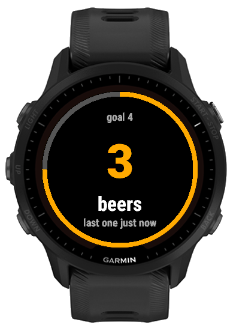

# Beer Run

A Connect IQ watch app for Garmin Forerunner watches (955 / 955 Solar, 255 / 255S and their Music versions, and 55) that counts the beers in a drinking session.

<a href="https://apps.garmin.com/en-US/apps/b6925eb7-3824-4fe2-8256-acb0e89ff6e6"></a>



The app is in English, Portuguese and German, following the watch language.

## Using the app

### Adding a beer

Press START or double-tap the screen. The watch buzzes, and the screen shows how long ago the last one was.

Each beer after the first closes a lap, like pressing LAP on a run. For 5 seconds the watch shows how long the previous beer took and the litres so far, with a ring counting down. START still adds a beer; any other button or a tap closes it early.

### Pages

UP and DOWN move through three pages, which loop:

1. Counter: the beer count and the time since the last one.
2. Stats: the current session laid out like a running app, with a live timer, litres, beers, and the pace in time per litre.
3. Splits: the last few beers with how long each took, and the average.

### Menu

Hold UP on any page to open the menu. From there you can:

- Undo the last beer.
- Finish the session and save it to history. The watch beeps and shows that it saved.
- See the history of past sessions.
- Set the size or the goal.
- Discard the session without saving.

Finishing and discarding ask you to confirm. Undo and Finish only show up once the session has a beer.

### Goal and size

The goal is a scroll wheel from 1 to 30. Each session starts with "No goal". With a goal set, a ring around the edge fills up as you drink and turns red when you go over.

Every beer counts as the current size: small 330 ml, can 350 ml, pint 473 ml, half 500 ml, bottle 600 ml or stein 1 L (the German beer hall mug). It starts as a pint.

### Sessions

Everything is saved on the watch, so closing the app does not lose it. A session ends when you finish it from the menu, or by itself after 8 hours without a beer: the next beer then starts a new session.

### Glance

The glance shows the count, the time since the last beer and, with a goal set, a progress bar. Select it to open the app. The Forerunner 55 has no glance.

## Quickstart

The toolchain runs in Docker (`tools/garmin-dev`), because the Connect IQ simulator needs a WebKit version that current Fedora does not ship. The Garmin SDK, the device files and your login live in `~/.Garmin`. The signing key lives in `~/.connectiq`. Both are mounted into the container.

First time only:

```bash
make image   # build the toolchain image
make login   # accept the SDK license and sign in to Garmin in the browser
make sdk     # download the SDK and the device files
```

`make login` saves a token that renews itself. Run it again only if `make sdk` fails with a login error.

Develop:

```bash
make sim     # build and open the app in the simulator
make build   # build bin/beer-fr955.prg
make package # build bin/beer.iq for the Connect IQ Store
make down    # stop the container
```

Install on the watch (plug it in over USB first):

```bash
make upload  # build and copy the app to the watch
make eject   # eject it; the watch installs the app once unplugged
```
